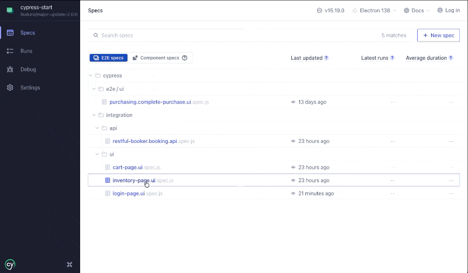

# Cypress Testing Framework

[](https://github.com/IvanZdanovich/cypress-start/actions/workflows/weekly-cypress-tests.yml)
<p style="text-align: center;">  
    <picture>
      <source media="(prefers-color-scheme: dark)"  srcset="./assets/cypress-logo-dark.png">
      <source media="(prefers-color-scheme: light)" srcset="./assets/cypress-logo-light.png">
      
    </picture>
</p>

A Cypress and JavaScript starter framework in which the test spec is the requirement. Use it to start a new test
project, or to add its lint rules, parallel runner, reports, and Claude Code skills to an existing one.

## Table of Contents

- [Quick Start](#quick-start)
- [Overview](#overview)
- [What Makes This Framework Different](#what-makes-this-framework-different)
- [Features](#features)
- [Running Tests](#running-tests)
    - [Standard Test Run](#standard-test-run)
    - [Parallel Test Execution](#parallel-test-execution)
    - [Environment-Specific Test Run](#environment-specific-test-run)
    - [Debug Mode](#debug-mode)
    - [GitHub Actions Workflow](#github-actions-workflow)
- [Documentation](#documentation)
- [Troubleshooting](#troubleshooting)

## Quick Start

### Prerequisites

- Node.js >= 26
- npm
- Git

### Create a project with the cypress-start CLI

```bash
# Create a new project folder
npx cypress-start my-project

# Or copy selected modules into the current directory
npm exec --yes --package=cypress-start@latest -- cypress-start .
```

The CLI asks for one of three setup modes:

**Mode 1 — Full Setup** clones the complete framework, initializes a fresh git repo, and runs `npm install`. Use it for
a new standalone project.

**Mode 2 — Specific Files** copies selected modules (ESLint rules, Docs, Claude Skills, Parallel Runner, GitHub Actions,
Docker) into an existing project directory. `package.json` is created or merged automatically; run `npm install`
afterwards.

**Mode 3 — Update Existing Project** refreshes a project you already created, in place. It pulls the latest template,
adds or overwrites managed files, deletes files that are no longer part of the template, and merges `package.json`
while keeping your custom scripts. Every change is staged with `git add -A`, so you can review and roll back individual
edits before committing:

```bash
# From inside the project (or: npm exec --yes --package=cypress-start@latest -- cypress-start ./path/to/project)
npx cypress-start
# choose "3. Update Existing Project"

git diff --staged                 # review everything the update changed
git restore --staged <file>       # unstage a file you want to keep as-is
git restore <file>                # discard the update for that single file
```

The update never overwrites `package.json` (it merges it) or the `cypress/sensitive-data/*-users.json` credential
files. Deleting obsolete files relies on the `.cypress-start-manifest.json` written on install and update.

### Alternative setup

**GitHub template:** open https://github.com/IvanZdanovich/cypress-start, click **Use this template**, create the
repository, and clone it.

**Direct clone:**

```bash
git clone https://github.com/IvanZdanovich/cypress-start.git my-project
cd my-project
npm install
```

### Add test credentials

Before the first run, copy `cypress/sensitive-data/env-users.example.json` to `cypress/sensitive-data/dev-users.json`
and `cypress/sensitive-data/qa-users.json`, and fill in the users for each environment.

### First commands

```bash
cd my-project
npm run test              # run all tests headless
npm run test:parallel     # run tests in parallel
npm run lint              # fix and report ESLint issues
npm run debug             # open the Cypress UI
```

> **Open Source** — MIT licensed. Use it, fork it, contribute back.

---

## Overview

The framework includes example tests for two public demo applications:

- Integration and E2E UI tests for the [Swag Labs demo application](https://www.saucedemo.com/).
- Integration API tests for the [Restful Booker API playground](https://restful-booker.herokuapp.com/apidoc/).



---

## What Makes This Framework Different

- **The spec is the requirement.** Tests follow a Constraints → Examples → Specs model. Boundary values live in
  constraint files, named data instances in example files, and requirements as executable Given/When/Then titles in
  spec files. There are no separate requirement documents, mapping matrices, or test-management tools.
  ([docs](docs/constraints-examples-specs-approach.md))
- **No extra abstraction layers.** No Page Object Model and no BDD framework. Selectors are plain objects, reused flows
  are Cypress custom commands, and Given/When/Then lives in test titles, so reports stay readable for non-technical
  readers. The reasons are in the [FAQ](docs/faq.md).
- **Conventions enforced by tools.** Custom ESLint rules check title grammar, spec file paths, command names, and
  `req` metadata on every lint run and commit.
- **Fast feedback.** Setup runs once per block in `before` hooks, sessions are cached, and specs run in parallel
  streams.
- **Few dependencies.** Cypress, mochawesome, ESLint with Prettier, and a handful of small helpers.
- **AI-ready.** [Claude Code](https://claude.ai/code) skills under `.claude/skills/` and path-scoped rules under
  `.claude/rules/` teach an AI agent the project conventions.

---

## Features

- **Interactive CLI setup:** Full Setup, Specific Files, or Update Existing Project.
- **Parallel test execution:** Configurable stream count and chunking strategy ([docs](docs/parallel-execution.md)).
- **Localization testing:** Typed `l10n` map generated from flat locale files ([docs](docs/localization-testing.md)).
- **Colour theme testing:** Typed `colours` map generated from flat theme files ([docs](docs/colour-theme-testing.md)).
- **Coverage gap analysis:** Compares implemented tests with the expected structure and reports missing paths, skipped
  tests, and coverage percentages, with an optional CI threshold ([docs](docs/coverage-gap-analysis.md)).
- **Flaky test analysis:** Stores CI test outcomes across runs on an orphan branch, then classifies failing tests as
  flaky, consistent, or rare ([docs](docs/flaky-test-analysis.md)).
- **Sign-off report:** Builds an interactive HTML checklist of every requirement from the specs and the latest run
  ([docs](docs/signoff-report.md)).
- **Custom ESLint rules:** Enforce test structure and naming conventions ([docs](docs/eslint-custom-rules.md)).
- **Pre-commit checks:** Sync, spec-path, and lint checks before every commit ([docs](docs/pre-commit-check.md)).
- **CI/CD integration:** GitHub Actions workflow with test filtering, optional reports, and Docker support.
- **Claude Code guidance:** 12 skills (Constraints → Examples → Specs, constraints, examples, bug tracking,
  localization, colour themes, non-functional testing, functional JavaScript, and authoring skills, rules, agents, and
  docs) plus 7 path-scoped rules for API, UI, and E2E specs, commands, constraints, examples, and guidance files.
  Claude Code loads a skill when the task matches, or when you call it with `/skill-name`.

---

## Running Tests

### Standard Test Run

Run all tests headless with the default settings:

```bash
npm run test
```

`npm run test` first runs `pretest`, which activates the locale and colour theme files and regenerates their types.

### Parallel Test Execution

```bash
# Default (3 parallel streams)
npm run test:parallel

# Custom stream count
PARALLEL_STREAMS=6 npm run test:parallel
```

### Environment-Specific Test Run

Set these environment variables to change the run:

- `LANGUAGE`: Language code (default: `en`)
- `TARGET_ENV`: Target environment, `qa` or `dev` (default: `qa`; the Docker image and CI workflow default to `dev`)
- `COLOUR_THEME`: Colour theme (default: `default`)
- `BROWSER`: Browser for `npm run test:parallel` and Docker runs (default: `chrome`; the CI workflow offers `chrome` and
  `edge`). `npm run test` uses Cypress's default Electron browser.

**macOS/Linux:**

```bash
LANGUAGE=en COLOUR_THEME=default TARGET_ENV=dev npm run test
BROWSER=edge TARGET_ENV=dev npm run test:parallel
```

**Windows (PowerShell):**

```powershell
$env:LANGUAGE="en"; $env:COLOUR_THEME="default"; $env:TARGET_ENV="qa"; npm run test
```

**Windows (CMD):**

```cmd
set LANGUAGE=en&& set COLOUR_THEME=default&& set TARGET_ENV=qa&& npm run test
```

### Debug Mode

Open the Cypress UI in Chrome with the English locale and default theme:

```bash
npm run debug
```

To debug against another environment, set `TARGET_ENV` first, for example `TARGET_ENV=dev npm run debug` on
macOS/Linux or `$env:TARGET_ENV="dev"; npm run debug` in PowerShell.

---

### GitHub Actions Workflow

`.github/workflows/weekly-cypress-tests.yml` runs every Sunday at 02:00 UTC and can be started manually.

To start it manually:

1. Open the **Actions** tab and select **Weekly Cypress Tests**.
2. Click **Run workflow**, set the inputs, and click **Run workflow**.

**Inputs:**

- `language` — Language code (default: `en`)
- `target_env` — Target environment (default: `dev`)
- `colour_theme` — Colour theme (default: `default`)
- `parallel_streams` — Number of parallel streams, 1–4 (default: `2`)
- `browser` — `chrome` or `edge` (default: `chrome`)
- `test_scope` — `all`, `integration`, or `e2e` (default: `all`)
- `test_type` — `all`, `api`, or `ui` (default: `all`)
- `run_cypress_tests` — run the Cypress tests (default: `true`)
- `generate_coverage_report` — build the coverage gap report (default: `false`)
- `generate_flaky_report` — build the flaky test report (default: `false`)
- `flaky_report_env` — scope of the flaky report: `dev`, `qa`, or `all` (default: `dev`)
- `generate_signoff_report` — build the HTML sign-off report (default: `false`)

**Test filtering:**

- `all` scope + `all` type → all tests in the workspace
- `all` scope + `api` type → all API tests (integration only)
- `all` scope + `ui` type → all UI tests (integration + e2e)
- `integration` scope + `all` type → all integration tests (api + ui)
- `integration` scope + `api` type → integration API tests only
- `integration` scope + `ui` type → integration UI tests only
- `e2e` scope + `all` type → all E2E tests
- `e2e` scope + `ui` type → E2E UI tests only

**Results:** check the **Actions** tab for run status, and download the reports and screenshots from the run's
artifacts.

---

## Documentation

**Test development:**

- [Constraints → Examples → Specs](docs/constraints-examples-specs-approach.md)
- [CES vs. traditional RM tools](docs/comparison-spec-vs-rm-tool.md)
- [FAQ — why the framework works this way](docs/faq.md)
- [Timeouts](docs/timeouts.md)

**Features and tools:**

- [Parallel execution](docs/parallel-execution.md)
- [Localization testing](docs/localization-testing.md)
- [Colour theme testing](docs/colour-theme-testing.md)
- [Coverage gap analysis](docs/coverage-gap-analysis.md)
- [Flaky test analysis](docs/flaky-test-analysis.md)
- [Sign-off report](docs/signoff-report.md)

**Quality and standards:**

- [Custom ESLint rules](docs/eslint-custom-rules.md)
- [Pre-commit check](docs/pre-commit-check.md)

**Git and collaboration:**

- [Git strategy](docs/git-strategy.md)

---

## Troubleshooting

### Common Issues

- **User data not found for role:** `cypress/sensitive-data/<env>-users.json` is missing or has no entry for the role.
  Create it from `env-users.example.json`; see [Add test credentials](#add-test-credentials).
- **`Invalid TARGET_ENV`:** `TARGET_ENV` must be `qa` or `dev`.
- **Pretest script fails:** the locale or theme file for `LANGUAGE` or `COLOUR_THEME` is missing. Check
  `cypress/localization/<lang>-localization.json` and `cypress/colours/<theme>-theme-colours.json`.
- **Localization or colour key errors:** run `npm run l10n:validate` or `npm run colours:validate` to list missing keys,
  and `npm run sync` to align the files.
- **State leaks between tests:** check that `{ testIsolation: false }` is set on the `describe` block and that each
  context restores the state the next one expects.
- **ESLint errors:** run `npm run lint` to fix what can be fixed and list the rest.

### Updating Dependencies

Update all dependencies to their latest versions, then reinstall:

```bash
npx npm-check-updates -u
npm install
```
